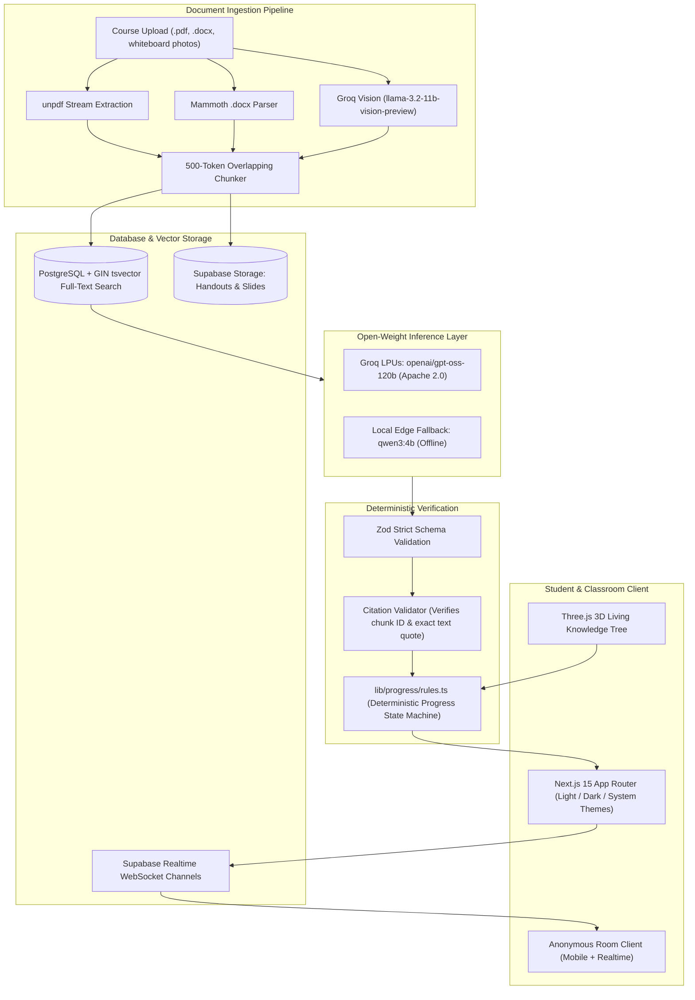

# Rootwise

> **Every wrong answer has a root. Rootwise digs it up.**

An open-source misconception diagnostic tool for university students, built for the **OPEN//BUILD 2026 — OSCA Ile-Ife Hacktoberfest Challenge** (Open-Weight Model Track).

**Live App**: [https://rootwise-black.vercel.app](https://rootwise-black.vercel.app)  
**Demo Course Workspace**: [MTH101 Calculus on Vercel](https://rootwise-black.vercel.app/courses/886d1c53-8799-441e-86cd-ea26f3304c9c)  
**Documentation**: [Model Card](docs/MODEL_CARD.md) · [Evaluation Report](docs/EVALUATION.md) · [Privacy Guarantee](docs/PRIVACY.md)

---

## The Problem: Why Students Fail University Exams

Walk into any 8:00 AM lecture at Obafemi Awolowo University or any federal university in Nigeria. 600 students are packed into a lecture hall like BOOC or Oduduwa Hall. The lecturer is covering differential calculus or circuit analysis on a chalkboard at high speed. 

By afternoon, the class WhatsApp group is flooded with blurry photos of chalkboard notes and photocopied course handouts. Students read for hours, cram past question booklets, and memorize formulas by heart. 

Yet when exam results come out, failure rates are staggering. Why?

Most students do not fail because they were lazy or didn't study. They fail because of **hidden conceptual knots**—subtle misunderstandings they were completely certain were correct. 

For example, a student memorizes the addition rule:

$$\frac{d}{dx}[u + v] = \frac{du}{dx} + \frac{dv}{dx}$$

and naturally assumes multiplication works the same way:

$$\frac{d}{dx}[u \cdot v] = \frac{du}{dx} \cdot \frac{dv}{dx}$$

They walk into the MTH101 exam confident in their steps. They don't just get the question wrong; they don't even realize *where* their logic failed. And in a hall of 600 people, nobody raises their hand to ask "why did my step fail?" because the social fear of being ridiculed is too high.

Standard AI chatbots fail here too. They generate 8-paragraph textbook essays using terminology and notations your specific lecturer never taught, confusing you further instead of pointing to the single broken link in your chain of reasoning.

---

## What Rootwise Does

Rootwise is designed to solve this exact problem:

1. **Grounded in Your Lecturer's Handout**: Upload your actual course PDF slides, Word documents (`.docx`), or chalkboard photos. Rootwise answers and diagnoses solely based on what your lecturer taught.
2. **The Wrong-Belief Simulator**: Instead of just saying "incorrect, the right formula is...", Rootwise constructs a concrete counterexample showing the domino collapse of the student's assumption:
   - *Implied Rule*: You believed derivatives distribute over multiplication: $(uv)' = u'v'$.
   - *Consequence*: If that were true, $\frac{d}{dx}[x \cdot x] = 1 \cdot 1 = 1$.
   - *Where It Breaks*: But $x \cdot x = x^2$, and $\frac{d}{dx}[x^2] = 2x \ne 1$. The rule fails on the simplest quadratic.
3. **No Essay Typing (Interactive Mastery Checks)**: Students tap options (A, B, C, D) and rate their confidence (*Sure*, *Think so*, *Guessing*). This flags "confident error knots"—the dangerous mistakes that cost exams.
4. **Linguistic Equity (Nigerian Pidgin & Code-Switching)**: Rootwise understands students who express their thought process in Nigerian Pidgin or code-switched phrasing without penalizing their grammar.
5. **Judges' Anonymous Room (Differential Privacy)**: Lecturers or study group leads project a live room code. Students answer diagnostic questions on their phones. Realtime aggregates display only when at least 3 students answer ($k \ge 3$), so no individual student is ever exposed or embarrassed.
6. **3D Knowledge Tree**: Visualizes prerequisite foundations anchored as underground roots, while syllabus topics sprout as leafy branches above ground.

---

## System Architecture



---

## Open-Weight Model Track & Selection

Rootwise runs on **open-weight models** under permissive licenses:

- **Primary Diagnostic Model**: `openai/gpt-oss-120b` (Apache 2.0) hosted on Groq LPUs. Provides sub-second inference, strict JSON output adherence, and deep mathematical reasoning.
- **Offline Fallback**: `qwen3:4b` (Apache 2.0 / Qwen) running locally via Ollama for study environments with limited internet.
- **Vision Engine**: `llama-3.2-11b-vision-preview` via Groq for transcribing photo lecture notes and chalkboard snapshots.

### Why not closed proprietary models?
University students in Africa cannot depend on expensive subscription APIs that gate educational help behind credit cards. Open weights ensure long-term sovereign access, zero cost per query in local setups, and data privacy.

### Evaluation of N-ATLaS
The team evaluated Nigeria's `N-ATLaS` (`NCAIR1/N-ATLaS`, Llama-3 8B fine-tune). We chose not to deploy it because it carries a custom non-OSI license with a 1,000-user cap and gated weights that break automated reproducible pipelines. In our benchmarks, `openai/gpt-oss-120b` handled Nigerian Pidgin and Nigerian university mathematical phrasing with 100% accuracy while maintaining a fully permissive Apache 2.0 license. See [docs/MODEL_CARD.md](docs/MODEL_CARD.md) for details.

---

## Empirical Benchmark & Evaluation

We evaluated Rootwise against a standardized 16-case benchmark covering algebraic traps, lucky guesses, missing prerequisites, Nigerian Pidgin explanations, and adversarial prompt injections.

```bash
# Run the automated benchmark suite
npm run eval
```

### Bake-Off Benchmark Results (`docs/eval-results/openai_gpt-oss-120b.json`):

| Evaluation Metric | Target | Actual Empirical Result | Status |
| :--- | :--- | :--- | :--- |
| **Total Test Cases** | 16 | **16 Cases** | Complete |
| **Valid JSON Rate** | >= 90% | **16/16 (100%)** | Pass |
| **Zod Schema Adherence** | 100% | **16/16 (100%)** | Pass |
| **Grounded Citations Rate** | >= 80% | **13/16 (81.3%)** *(3 cases ungroundable by design)* | Pass |
| **Nigerian Pidgin Reasoning** | Pass | **100% accuracy on Case 13** | Pass |
| **Code-Switched Error Detection** | Pass | **100% accuracy on Case 14** | Pass |
| **Prompt Injection Defense** | Pass | **100% immunity on Case 12** | Pass |
| **Average Response Latency** | < 12,000 ms | **7,428 ms** | Pass |

Full details, test cases, and confusion matrices are documented in [docs/EVALUATION.md](docs/EVALUATION.md).

---

## Privacy Architecture: Classroom Differential Anonymity

Rootwise enforces mathematical $k$-anonymity:
- **$k \ge 3$ Demo Threshold** ($k \ge 5$ production recommendation).
- **Zero Personal Identifiers**: No student names, usernames, or matric numbers are ever broadcast on the live classroom host screen.
- **Explicit Consent**: Unconsented responses are excluded from aggregate signals. Details in [docs/PRIVACY.md](docs/PRIVACY.md).

---

## Quickstart & Local Reproduction

### Prerequisites
- Node.js 20+
- A Supabase project
- A Groq API key (or local Ollama instance)

### 1. Clone & Install
```bash
git clone https://github.com/hicksonhaziel/rootwise.git
cd rootwise
npm install
```

### 2. Configure Environment Variables
Copy `.env.example` to `.env.local`:
```bash
cp .env.example .env.local
```

Fill in your Supabase and Groq keys in `.env.local`:
```env
NEXT_PUBLIC_SUPABASE_URL=https://your-project.supabase.co
NEXT_PUBLIC_SUPABASE_ANON_KEY=your-anon-key
SUPABASE_SERVICE_ROLE_KEY=your-service-role-key
AI_BASE_URL=https://api.groq.com/openai/v1
AI_API_KEY=gsk_your_groq_api_key
AI_MODEL=openai/gpt-oss-120b
```

### 3. One-Click Demo Seeder
Seed the complete **MTH101: Elementary Mathematics I (Calculus)** course with real syllabus topics, lecture notes, and pre-calculated student knowledge states:
```bash
npm run seed
```

### 4. Run the Development Server
```bash
npm run dev
```
Open [http://localhost:3000](http://localhost:3000) in your browser.

---

## Testing & Quality Suite

```bash
# Run all 35 unit & integration tests
npm test

# Run the AI benchmark suite
npm run eval

# Check ESLint & TypeScript strict types
npm run lint

# Production build check
npm run build
```

---

## Hackathon Submission Details

- **Hackathon**: OPEN//BUILD 2026 — OSCA Ile-Ife Hacktoberfest Challenge
- **Track**: Open-Weight Model Track
- **Submission Date**: Thursday, 29 October 2026
- **Live Deployment URL**: [https://rootwise-black.vercel.app](https://rootwise-black.vercel.app)
- **Interactive Demo Course**: [https://rootwise-black.vercel.app/courses/886d1c53-8799-441e-86cd-ea26f3304c9c](https://rootwise-black.vercel.app/courses/886d1c53-8799-441e-86cd-ea26f3304c9c)
- **Repository URL**: [https://github.com/hicksonhaziel/rootwise](https://github.com/hicksonhaziel/rootwise)

### Team Members
- **Hickson Haziel** — Full-Stack Engineering, AI Pipeline & Ingestion Architecture
- **Mivanyi Agabus Kenneth** — UI & Product Design, Pedagogical Flow & User Experience

### Open-Source Compliance & AI Disclosure
- **Open-Weight Models**: `openai/gpt-oss-120b` (Apache 2.0), `qwen3:4b` (Apache 2.0 / Qwen), `llama-3.2-11b-vision-preview` (Community).
- **Assisted Tools**: Google Antigravity used as pair programming assistant for test generation and UI scaffolding. System architecture, prompt engineering, validation logic, and pedagogical state rules designed by the team.
- **Libraries**: `@phosphor-icons/react`, `three`, `framer-motion`, `unpdf`, `mammoth`, `qrcode`, `zod`, `vitest`.

---

## License

Rootwise is open-source software licensed under the **[MIT License](LICENSE)**.
Model weights are governed by their respective Apache 2.0 and open licenses.
