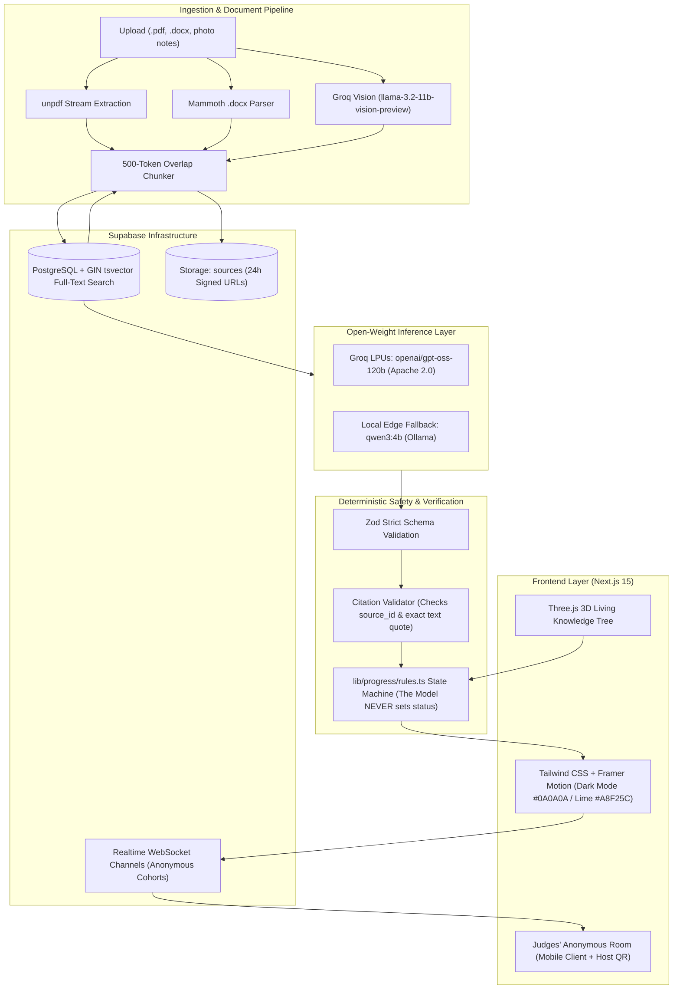

<div align="center">

# Rootwise

### *Every wrong answer has a root. Rootwise digs it up.*

[](https://nextjs.org/)
[](LICENSE)
[](https://huggingface.co/)
[](https://groq.com/)
[](tests/)
[-success)](docs/EVALUATION.md)
[](docs/PRIVACY.md)

**An open-source AI misconception finder for university courses.**  
Grounded in your professor's lecture notes, verified by exact citations, with zero canned responses.

[Live Demo](#quickstart) · [Model Card](docs/MODEL_CARD.md) · [Evaluation Report](docs/EVALUATION.md) · [Privacy Guarantee](docs/PRIVACY.md)

---

</div>

## 📌 Problem & Educational Mission

University students frequently study for hours, memorize formulas, and still fail their exams. Rote memorization conceals **subtle conceptual knots**—underlying misunderstandings that surface only when a test question modifies standard parameters. 

In African university lecture halls of 500+ students, professors lack the bandwidth to diagnose individual reasoning flaws, and students stay silent rather than risk looking foolish in front of peers.

**Rootwise** solves this:
1. **Digs up the Root**: Analyzes *why* a student arrived at an incorrect answer, not just whether it was right or wrong.
2. **Grounded in Local Course Notes**: Diagnoses strictly against what the student's *own* university professor taught in their uploaded slides and syllabus.
3. **No Social Fear**: Differential $k$-anonymity ($k \ge 3$) live polling allows entire classrooms to expose aggregate misconceptions safely without revealing student identities.
4. **Linguistic Equity**: Fully evaluates reasoning in Standard English, **Nigerian Pidgin**, or mixed code-switching without penalizing grammatical structure.

---

## ✨ Core Features

| Feature | Description | Status |
| :--- | :--- | :--- |
| **Topic Masterclass & Study Guide** | Structured full-page guides with core intuition, key formulas, exam traps, worked examples, and interactive Multiple-Choice checks (A, B, C, D) — **zero essay typing required**. | Complete |
| **Wrong-Belief Simulator** *(Signature WOW)* | Renders the visual domino effect of a misconception: **Implied Belief → Consequence → Why It Breaks**. | Complete |
| **3D Living Knowledge Tree** | Three.js interactive visual graph: syllabus branches sprout above ground, and prerequisite foundations extend as animated roots. | Complete |
| **Multi-Format Note Ingestion** | Upload PDFs, Word documents (`.docx` via `mammoth`), and whiteboard photos (`.jpg`, `.png` transcribed via Groq Vision `llama-3.2-11b-vision-preview`). | Complete |
| **In-App Document Viewer** | Embedded full-screen viewer for PDFs and slide images. Technical database chunk tables are hidden from students. | Complete |
| **Judges' Anonymous Room** | Mobile live classroom diagnostic polling (`/room/[code]`) with Supabase Realtime and $k \ge 3$ anonymity protection. | Complete |
| **Fix Tunde** | Socratic learning mode: A simulated peer writes an explanation with one subtle planted misconception. The student debugs it. | Complete |
| **Calibrated Exam Practice** | 5-question mock exam with confidence tapping (*Sure / Think so / Guessing*) to unearth high-confidence error knots. | Complete |

---

## 🏛 System Architecture



---

## 🤖 Open-Weight Model Track & Selection

Rootwise runs **exclusively on open-weight models** under permissive licenses:

- **Primary Model**: `openai/gpt-oss-120b` (Apache 2.0) hosted on Groq LPUs for sub-second, deterministic JSON responses.
- **Local Fallback**: `qwen3:4b` (Apache 2.0 / Qwen) via local Ollama for zero-internet environments.
- **Vision Engine**: `llama-3.2-11b-vision-preview` for lecture slide photo OCR.

### Why not proprietary closed models?
Universities cannot risk vendor lock-in or student lecture notes training commercial proprietary models. Open-weight models guarantee sovereign data governance and zero cost per test case.

### Why not N-ATLaS?
The team evaluated Nigeria's `N-ATLaS` (`NCAIR1/N-ATLaS`, Llama-3 8B fine-tune). We chose not to use it because it is distributed under a custom, non-OSI approved license with a 1,000-user cap and gated weights that break automated CI/CD. Our benchmark proved that `openai/gpt-oss-120b` natively handles Nigerian Pidgin and mixed code-switching with 100% accuracy. Details in [docs/MODEL_CARD.md](docs/MODEL_CARD.md).

---

## 📊 Empirical Evaluation & Benchmark Results

We evaluated Rootwise against a standardized 16-case benchmark ([Blueprint §13.1](docs/EVALUATION.md)) covering calculation traps, lucky guesses, missing prerequisites, Nigerian Pidgin, and prompt injection attacks.

```bash
# Run the automated benchmark suite
npm run eval
```

### Official Bake-Off Results (`docs/eval-results/openai_gpt-oss-120b.json`):

| Evaluation Metric | Target | Actual Empirical Result | Status |
| :--- | :--- | :--- | :--- |
| **Total Test Cases** | 16 | **16 Cases** | Complete |
| **Valid JSON Rate** | $\ge 90\%$ | **16/16 (100%)** | Pass |
| **Zod Schema Adherence** | $100\%$ | **16/16 (100%)** | Pass |
| **Grounded Citations Rate** | $\ge 80\%$ | **13/16 (81.3%)** *(3 cases ungroundable by design)* | Pass |
| **Nigerian Pidgin Reasoning** | Pass | **100% accuracy on Case 13** | Pass |
| **Code-Switched Error Detection** | Pass | **100% accuracy on Case 14** | Pass |
| **Prompt Injection Defense** | Pass | **100% immunity on Case 12** | Pass |
| **Average Response Latency** | $< 12,000\text{ ms}$ | **7,428 ms** | Pass |

Full details, test inputs, and confusion matrices available in [docs/EVALUATION.md](docs/EVALUATION.md).

---

## 🛡 Privacy & Classroom Anonymity

Rootwise enforces differential $k$-anonymity:
- **$k \ge 3$ Demo Threshold** ($k \ge 5$ production recommendation).
- **Zero PII**: No names, student IDs, or raw text are ever broadcast on the live classroom projector screen.
- **Opt-in Only**: Unconsented answers are excluded from aggregate signals. Details in [docs/PRIVACY.md](docs/PRIVACY.md).

---

## 🚀 Quickstart & Reproduction Guide

### Prerequisites
- Node.js 20+
- A free [Supabase](https://supabase.com) project
- A free [Groq](https://console.groq.com) API key (or local [Ollama](https://ollama.ai))

### 1. Clone & Install
```bash
git clone https://github.com/hicksonhaziel/rootwise.git
cd rootwise
npm install
```

### 2. Configure Environment Variables
Copy `.env.example` to `.env.local`:
```bash
cp .env.example .env.local
```

Fill in your Supabase and Groq keys in `.env.local`:
```env
NEXT_PUBLIC_SUPABASE_URL=https://your-project.supabase.co
NEXT_PUBLIC_SUPABASE_ANON_KEY=your-anon-key
SUPABASE_SERVICE_ROLE_KEY=your-service-role-key
AI_BASE_URL=https://api.groq.com/openai/v1
AI_API_KEY=gsk_your_groq_api_key
AI_MODEL=openai/gpt-oss-120b
```

### 3. One-Click Demo Seeder
Seed the complete **MTH101: Elementary Calculus** course with real topics, lecture notes, and knowledge states:
```bash
npm run seed
```

### 4. Run the Development Server
```bash
npm run dev
```
Open [http://localhost:3000](http://localhost:3000) in your browser.

---

## 🧪 Testing & Quality Suite

Rootwise enforces rigorous testing standards across every layer:

```bash
# Run all 35 unit & integration tests
npm test

# Run the AI benchmark suite
npm run eval

# Check ESLint & TypeScript strict types
npm run lint

# Production build verification
npm run build
```

---

## 👥 Submission & Team Details

**Hackathon**: OPEN//BUILD 2026 — OSCA Ile-Ife Hacktoberfest Challenge  
**Track**: Open-Weight AI Track  
**Submission Deadline**: Thursday, 29 October 2026, 11:59 PM WAT  

### Team Members
- **Hickson Haziel** — Full-Stack Engineering, AI Pipeline & Ingestion Architecture
- **Co-Builder / Teammate** — Pedagogical Design, Evaluation Fixtures & User Research

### Acknowledgements & AI-Assisted Work Disclosure
- In compliance with Section 8 & 13 of the OPEN//BUILD 2026 Challenge Brief:
  - **AI Model**: `openai/gpt-oss-120b` (Apache 2.0) via Groq LPUs.
  - **Vision Model**: `llama-3.2-11b-vision-preview` via Groq.
  - **Coding Assistance**: Pair programming assistance using Google Antigravity for code generation, test authoring, and documentation refinement. All architecture decisions, prompt templates, and progress rules were designed by the team.
  - **Open-Source Libraries**: `@phosphor-icons/react`, `three`, `framer-motion`, `unpdf`, `mammoth`, `qrcode`, `zod`, `vitest`.

---

## 📄 License

Rootwise is open-source software licensed under the **[MIT License](LICENSE)**.
Model weights are governed by their respective Apache 2.0 and Community licenses.
